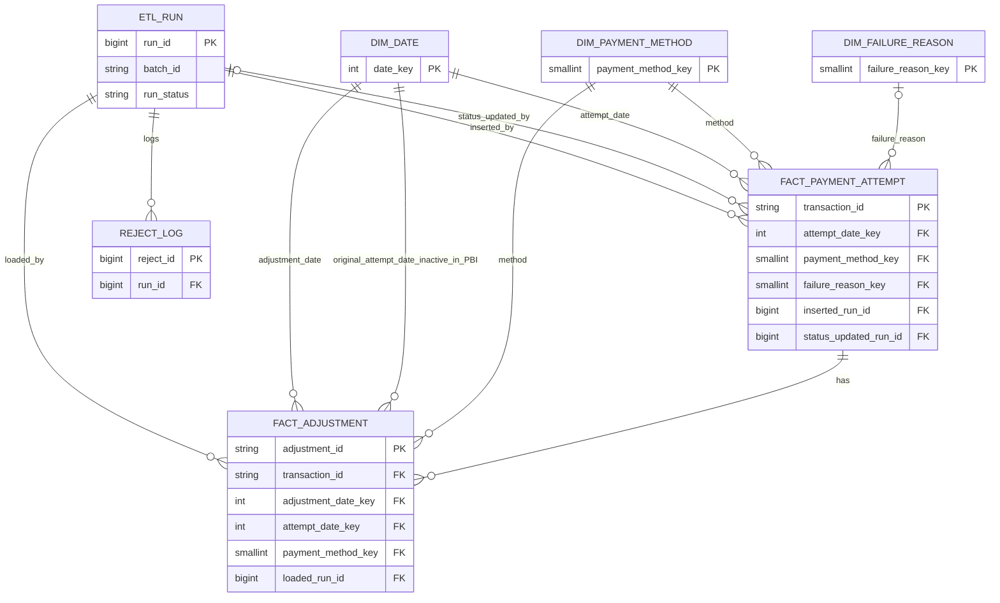

# Financial Intelligence | Data Model

**Version:** 0.7 — Phase 2 Steps 1–4 locked; Step 5 pending  
**Basis:** Phase 1 `business_requirements.md` and `kpi_definitions.md` v1.0 Approved.  
**Status:** Steps 1–4 reviewed and locked. Step 5 column mapping and physical DDL remain pending.

## 1. Data layers

| Layer | Purpose | Data policy | Dashboard access |
|---|---|---|---|
| **Staging** (`stg`) | Preserve incoming source attempts and adjustments with ingestion metadata, before business-rule acceptance. Enables traceability, deterministic first-row processing and source-to-curated reconciliation. | Append incoming rows with `batch_id` and `source_row_ref`/source sequence; keep original UTC values and raw controlled-value strings. No overwriting of source rows. | None: not trusted for KPIs. |
| **Curated** (`cur`) | Store validated, current payment attempts, immutable adjustment events and reusable reporting dimensions. | Only rows passing Phase 1 validation; one current attempt per `transaction_id`, one accepted adjustment per `adjustment_id`. A valid Pending→final transition updates the existing attempt; adjustment events never change its success status. | Power BI reads curated model. |
| **Audit** (`audit`) | Record batch execution/replay and rejected source rows with reason codes. | Keep `etl_run` at **one row per execution** (`run_id` PK, non-unique `batch_id`) for cutoff, counts and status; `reject_log` at **one row per rejected source row**. Replays create a new `ALREADY_PROCESSED` run with zero mutations. | Operational validation, not business KPI totals. |

**Why staging is separate:** Source data can be duplicated, malformed or later corrected. Staging preserves what actually arrived; curated exposes only accepted records. Audit explains every difference. Directly reporting from staging would make KPI counts and incremental reruns unreliable.

**Load order (logical):** create an audit run and check whether `batch_id` already completed successfully → if yes, record `ALREADY_PROCESSED` (0 inserts, 0 updates, 0 rejects) and **stop before staging** → otherwise append raw attempt and adjustment rows to staging → validate/upsert attempts (including Pending→Success) → validate/insert adjustments → reconcile first-run inputs by entity type → update run status to `COMPLETED` with final counts **inside the same data transaction as its final statement** → commit atomically. Staging uses `UNIQUE(batch_id, source_row_ref)` **per staging table**; source row references must be unique within each entity stream. A prior `FAILED` or stale `RUNNING` execution does **not** count as completed. Create/commit the `RUNNING` run record separately; wrap staging inserts, curated mutations, reject rows, reconciliation counts, and the final `etl_run` `COMPLETED`/counts update in one SQL transaction. On failure, roll back that transaction, then record `FAILED` and error details in a separate transaction. A retry of the same batch is therefore safe. A stale `RUNNING` execution requires an operator-confirmed retry after ensuring no active worker is processing it; it is never treated as `COMPLETED`.

## 2. Table inventory and grain

| Layer | Proposed table | Grain (one row per…) | Responsibility |
|---|---|---|---|
| Staging | `stg.payment_attempt_raw` | Source attempt row within an ingestion batch | Original attempt payload; `batch_id`, `source_row_ref`, deterministic source order. Repeated IDs are retained here for validation. |
| Staging | `stg.adjustment_raw` | Source adjustment row within an ingestion batch | Original adjustment payload; `batch_id`, `source_row_ref`, deterministic source order. |
| Curated | `cur.fact_payment_attempt` | Accepted `transaction_id` | Current status, original USD amount, UTC attempt timestamp, `merchant_id` attribute, `inserted_batch_id`, `status_updated_batch_id`, `inserted_run_id`, `status_updated_run_id`, `status_updated_at`; links to method, failure reason and attempt date. |
| Curated | `cur.fact_adjustment` | Accepted `adjustment_id` | Immutable Refund/Reversal event, amount, UTC event timestamp, original `transaction_id`, adjustment date, original attempt date, payment method, `loaded_batch_id`, and `loaded_run_id`. Multiple refunds per attempt possible. |
| Curated | `cur.dim_date` | ET calendar date | Shared calendar dimension: role-played as attempt date and adjustment event date. Date slicer applies separately to each KPI's specified date basis. |
| Curated | `cur.dim_payment_method` | Allowed payment method | `Card`, `ACH`, `Wallet`; controls method values and labels. |
| Curated | `cur.dim_failure_reason` | Allowed failure reason code | Phase 1's seven codes; nullable relationship for non-Failed attempts. |
| Audit | `audit.etl_run` | **One execution (`run_id`)** | `run_id` PK; `batch_id` non-unique; extraction/as-of cutoff, run status, per-entity inserted/updated/rejected counts. Completed-batch replay creates another run with `ALREADY_PROCESSED` and zero mutations. |
| Audit | `audit.reject_log` | **One rejected source row** | `run_id`, `batch_id`, entity type, record ID, source row reference, **one primary reason code** and optional `details` for additional violations. No double counting of rejected input rows. |

### Modeling decisions carried from Phase 1

- **Attempt vs adjustment are different grains.** Do not flatten multiple refunds into the attempt fact: that would duplicate payment value and corrupt success rate.
- **Business keys vs surrogate keys:** `transaction_id`, `adjustment_id` and `merchant_id` originate in synthetic source; `merchant_id` remains an immutable fact attribute, **not** a merchant dimension. Method/reason dimensions may use warehouse-generated surrogate keys. PK/FK choices are specified in Step 3.
- **Rejection counting:** one rejected input row contributes exactly one reject count. When multiple rules fail, use the six-stage deterministic precedence defined in Step 4 (Closed reject reason codes and deterministic precedence). Preserve additional diagnostics in `details`. This precedence is a logging convention, not a change to Phase 1 acceptance rules.
- **Batch lineage:** curated facts retain originating batch IDs for traceability and corresponding successful run IDs as enforceable audit FKs. An as-of cutoff still filters by adjustment event timestamp, **not** merely by batch ID. **v1 does not support point-in-time reconstruction of past report states; batch IDs are for lineage and reconciliation only.**
- **ET reporting:** retain UTC event timestamps; derive ET dates and ET hour for reporting, preserving DST-aware conversion. Shared `dim_date` supports the two distinct date roles, not a single ambiguous date relationship.
- **Scope discipline:** merchant segmentation is not a Phase 1 business question; omit `dim_merchant`. Keep controlled status and adjustment type as validated values (SQL CHECK / ETL), not separate dimensions.
- **Failure reason:** only Failed attempts have a code; the seven controlled codes come from Phase 1. No extra statuses or methods are introduced.
- **Settlement:** 24-hour synthetic proxy is a validation rule, **not** a new settlement table or actual settlement accounting.
- **As-of:** adjustment cohort measures use original attempt date and explicit cutoff; 30-day maturity is a reporting rule, not a separate transaction status.

## Review changes incorporated

1. Audit grain is execution (`run_id`), so a replay can be recorded without mutating the completed batch.
2. Completed-batch replay detection precedes staging writes; staging source-row references are unique per batch and stream.
3. Rejection grain is one source row with one primary reason and optional secondary details.
4. Curated fact lineage includes inserted/updated/loaded batch IDs; cutoff semantics remain event-time based.
5. Removed merchant dimension; kept immutable `merchant_id` on the attempt fact.
6. Step 3: adjustment fact carries parent-derived `attempt_date_key` and `payment_method_key` for independent dimension filtering in Power BI; no Power BI fact-to-fact relationship (SQL FK remains).
7. Step 3: Mermaid includes the nullable `status_updated_run_id` lineage relationship.

## 3. Keys, relationships and cardinalities (reviewed)

**Key choice:** Keep the Phase 1 source business IDs (`transaction_id`, `adjustment_id`) as the primary keys of their respective facts in v1. A separate numeric fact surrogate would add joins without solving a requirement. Dimension tables use small warehouse-generated integer keys; `merchant_id` remains a string attribute on the attempt fact.

| Table | Primary key | Unique / foreign keys | Relationship and notes |
|---|---|---|---|
| `audit.etl_run` | `run_id` (BIGINT identity) | `batch_id` **not unique** | One execution; status `RUNNING`, `COMPLETED`, `FAILED`, or `ALREADY_PROCESSED`. A completed run establishes a batch as processed. |
| `stg.payment_attempt_raw` | `attempt_raw_id` (BIGINT identity) | `UNIQUE(batch_id, source_row_ref)` | One source row; do not FK raw business IDs to curated facts (invalid/orphan data must be preserved). |
| `stg.adjustment_raw` | `adjustment_raw_id` (BIGINT identity) | `UNIQUE(batch_id, source_row_ref)` | One source row; raw parent may not exist or may be invalid. |
| `cur.dim_date` | `date_key` (INT, YYYYMMDD) | `UNIQUE(calendar_date_et)` | One ET calendar date. |
| `cur.dim_payment_method` | `payment_method_key` (SMALLINT) | `UNIQUE(payment_method_code)` | One allowed method. |
| `cur.dim_failure_reason` | `failure_reason_key` (SMALLINT) | `UNIQUE(failure_reason_code)` | One allowed failure code. |
| `cur.fact_payment_attempt` | `transaction_id` (source business key) | FKs: `attempt_date_key` → `dim_date`; `payment_method_key` → `dim_payment_method`; nullable `failure_reason_key` → `dim_failure_reason`; `inserted_run_id` and nullable `status_updated_run_id` → `audit.etl_run` | Many attempts per date/method/reason. Keep `inserted_batch_id` and nullable `status_updated_batch_id` for readable lineage; run IDs provide valid FKs because `batch_id` is not unique. |
| `cur.fact_adjustment` | `adjustment_id` (source business key) | FKs: `transaction_id` → `fact_payment_attempt`; `adjustment_date_key` and `attempt_date_key` → `dim_date`; `payment_method_key` → `dim_payment_method`; `loaded_run_id` → `audit.etl_run` | Many adjustments per successful attempt. Denormalized attempt date and payment method are copied from immutable parent fields at acceptance, validated on load, and used for unambiguous Power BI filtering. Keep `loaded_batch_id` as descriptive lineage. Success-only and cumulative-amount validation are ETL rules, not expressible as simple FK. |
| `audit.reject_log` | `reject_id` (BIGINT identity) | FK: `run_id` → `etl_run`; `UNIQUE(run_id, entity_type, source_row_ref)` | One rejection per source row in one run; raw source references need not FK to a single staging table. |

**Run lineage clarification:** Phase 1 names `inserted_batch_id`, `status_updated_batch_id`, and `loaded_batch_id` remain on facts. Step 3 adds `*_run_id` to make relational FKs possible; an FK directly to `etl_run.batch_id` is invalid because the batch ID repeats on replays. This is technical metadata, not a new business rule.

**Power BI relationships and slicers (test on a small fixture before locking):** Use single-direction dimension-to-fact relationships only. `dim_date[date_key]` → `fact_payment_attempt[attempt_date_key]` is active; → `fact_adjustment[adjustment_date_key]` is active; → `fact_adjustment[attempt_date_key]` is **inactive**. `dim_payment_method[payment_method_key]` filters **both** facts directly through active relationships. `dim_failure_reason` filters attempts only. Do **not** create a Power BI fact-to-fact relationship, although SQL Server retains `fact_adjustment.transaction_id` → `fact_payment_attempt.transaction_id` FK. Thus one synced date slicer filters payment KPIs by attempt date and adjustment amount cards by adjustment event date; label both bases. Cohort adjustment-rate measures activate the inactive adjustment attempt-date relationship with `USERELATIONSHIP`, apply an explicit as-of event cutoff, and must be fixture-tested for correct date/method filter behavior. The inactive relationship must replace, not intersect with, the adjustment-event-date filter for cohort measures. These relationship choices are implementation design, not additional business rules.

**Failure reason visual:** Filter `status = Failed` so nullable `failure_reason_key` on non-failed attempts does not introduce a misleading `(Blank)` reason.

**DDL boundary:** PK/FK and grain are documented here. Step 4 assigns SQL constraints versus ETL validations; Step 5 and physical DDL remain pending.

## 4. Phase 1 rules → SQL constraints vs Python/ETL validation (draft)

**Enforcement principle:** SQL Server constraints protect the accepted *current-state* curated tables even if ETL has a bug; Python validates source rows in deterministic order and assigns the Phase 1 reject codes **before** attempting a curated write. SQL errors are safeguards, not the normal mechanism for generating business rejection codes. Source payload remains in staging for diagnosis. Never silently drop a failed row.

| Phase 1 rule / invariant | SQL Server enforcement | Python ETL / batch enforcement | Rejection or audit outcome |
|---|---|---|---|
| One attempt per `transaction_id`; one adjustment per `adjustment_id` | Fact primary keys; `NOT NULL` business IDs | Validate missing/invalid IDs, deterministic intra-batch first-row wins | `DUPLICATE_IN_BATCH` for later same-ID row; cross-batch `DUPLICATE_RECORD` or `DUPLICATE_ADJUSTMENT` |
| Staging source identity | `UNIQUE(batch_id, source_row_ref)` on **each** raw table | Verify distinct source row references; do not append staging on completed-batch replay | Malformed batch fails safely; never count as a curated business reject unless source-row validation explicitly defines it |
| Attempt amount and currency | `DECIMAL(18,2) NOT NULL CHECK(amount_usd > 0)`; `CHECK(currency = 'USD')` | Strict parse, precision/scale checks before insert | Primary validation reason documented in reject log; no silent rounding of invalid input |
| Attempt statuses | `CHECK(status IN ('Pending','Success','Failed','Cancelled'))` | Validate source controlled value and allowed `Pending → final` transition | Invalid controlled value or `INVALID_STATUS_TRANSITION` |
| Payment methods | `NOT NULL` FK to `dim_payment_method`, whose codes are restricted to `Card`, `ACH`, `Wallet` by seed/DDL policy | Resolve source code to dimension key; reject unknown value | Controlled-value rejection |
| Failure reasons | Nullable FK to `dim_failure_reason`; `CHECK ((status='Failed' AND failure_reason_key IS NOT NULL) OR (status<>'Failed' AND failure_reason_key IS NULL))` | Validate seven codes; when status is terminal `Failed`, forbid changed failure reason | Invalid code rejection; changed final reason → `IMMUTABLE_FIELD_CONFLICT` |
| Immutable attempt fields | PK, column types and NOT NULL checks protect shape, **not** old-vs-new comparisons | Compare `transaction_id`, UTC attempt time, amount, currency, merchant ID, payment method to existing row; retain original values | `IMMUTABLE_FIELD_CONFLICT` |
| Attempt status finality | No simple `CHECK` can compare old/new row; curated writes restricted to ETL role / stored load procedure | Only update an existing `Pending` row to one final status; record `status_updated_at` and `status_updated_run_id` | `VALID_STATUS_UPDATE` or `INVALID_STATUS_TRANSITION` |
| UTC timestamps and ET calendar keys | `datetime2` UTC fields; FKs to `dim_date`; `NOT NULL` date keys | Parse UTC, reject future attempt timestamps relative to batch extraction cutoff; derive ET date/hour with DST-aware `America/New_York` conversion and resolve `date_key` | Invalid timestamp/date-key rejection |
| Adjustment type and positive amount | `CHECK(adjustment_type IN ('Refund','Reversal'))`; `DECIMAL(18,2) CHECK(amount_usd > 0)` | Validate raw type and amount, no changes to existing adjustment identity/fields | `ADJUSTMENT_FIELD_CONFLICT`, `DUPLICATE_ADJUSTMENT`, or controlled-value/amount rejection |
| Adjustment parent and Success-only | SQL FK `fact_adjustment.transaction_id` → `fact_payment_attempt.transaction_id` enforces existence, **not** status | Process attempts first; check parent exists and current status `Success` | `ORPHAN_ADJUSTMENT`, `ADJUSTMENT_ON_NON_SUCCESS` |
| Adjustment timing / synthetic settlement | Timestamp column types, no cross-table `CHECK` | Event ≥ attempt; `Reversal` < attempt UTC + 24h; `Refund` ≥ attempt UTC + 24h. For incremental Pending→Success, generator emits linked events after that batch cutoff | `INVALID_ADJUSTMENT_TIMING` |
| Reversal once/full; no refund after reversal; cumulative adjustment ≤ original | No simple row `CHECK` for aggregate or sibling-event rules | Validate against **already accepted** adjustments plus earlier accepted events in the same batch, in deterministic order; reversal amount = original amount and at most one; disallow refund if reversed | `INVALID_ADJUSTMENT_RULE` or `ADJUSTMENT_EXCEEDS_ORIGINAL` |
| Denormalized adjustment method/date keys | FKs to method/date dimensions; `NOT NULL` | Copy `attempt_date_key` and `payment_method_key` from validated original attempt, never trust independent adjustment source values | Fail/reject mismatched derived values before curated insert |
| Adjustment immutable fields | `adjustment_id` PK prevents second row, but cannot compare values | Compare original `transaction_id`, type, amount, UTC event time under same ID | `DUPLICATE_ADJUSTMENT` if identical; otherwise `ADJUSTMENT_FIELD_CONFLICT` |
| Batch replay and execution audit | `etl_run.run_id` PK; nonunique `batch_id`; status CHECK; FK lineage; reject uniqueness `(run_id,entity_type,source_row_ref)` | Check **COMPLETED** batch before staging; replay logs new `ALREADY_PROCESSED` run with zero mutations. Failed/stale RUNNING not completed; operator confirms retry after crash | Replay no-op; retry follows recovery protocol |
| Atomic load and reconciliation | One SQL transaction for staging + curated + rejects + reconciliation counts; independent committed run record | Commit `RUNNING` separately; on success mark the run `COMPLETED` with final counts as the last statement inside the data transaction, then commit together; on exception rollback data transaction and persist `FAILED` in a separate transaction. Reconcile each stream `input = inserted + updated + rejected` | One primary reject per source row; never double-count |
| Cohort cutoff and maturity | Store UTC event timestamps; no historical snapshot tables in v1 | Adjustment cohort measures use attempt ET date + explicit as-of event cutoff; immature if cutoff < ET cohort period end + 30 days; label date basis | Reporting/test logic, not source-row rejection |
| Aged pending >24h | No automatic status change or source-row rejection | Report/test logic compares Pending attempt UTC timestamp with run extraction cutoff; flag only | Operational exception flag, not reject |
| Failure-reason visual | Nullable reason FK allowed for non-Failed | Filter visuals to `status = 'Failed'` | Avoid `(Blank)` reason bucket |

### Closed reject reason codes and deterministic precedence

`audit.reject_log.reason_code` is restricted by a SQL `CHECK` (or a fixed seeded lookup) to the following **closed set**. These names classify existing Phase 1 validation outcomes; they do not introduce new acceptance rules.

| Category | Allowed `reason_code` | Example |
|---|---|---|
| Structural / parsing | `MISSING_REQUIRED_FIELD`, `INVALID_FORMAT`, `NONPOSITIVE_AMOUNT`, `FUTURE_ATTEMPT_TIMESTAMP` | Missing ID; invalid decimal or UTC timestamp; amount ≤ 0; attempt timestamp after extraction cutoff |
| Controlled values / status-reason consistency | `INVALID_CONTROLLED_VALUE`, `FAILURE_REASON_STATUS_MISMATCH` | Unknown payment method, status, adjustment type or failure code; Failed without reason or non-Failed with reason |
| Attempt identity / lifecycle | `DUPLICATE_IN_BATCH`, `DUPLICATE_RECORD`, `IMMUTABLE_FIELD_CONFLICT`, `INVALID_STATUS_TRANSITION` | Second occurrence in same batch; unchanged cross-batch attempt; changed immutable value; final status changed |
| Adjustment identity / parent / timing | `DUPLICATE_ADJUSTMENT`, `ADJUSTMENT_FIELD_CONFLICT`, `ORPHAN_ADJUSTMENT`, `ADJUSTMENT_ON_NON_SUCCESS`, `INVALID_ADJUSTMENT_TIMING` | Existing adjustment ID; changed adjustment field; missing/non-success parent; outside synthetic settlement window |
| Adjustment aggregate / sibling rules | `INVALID_ADJUSTMENT_RULE`, `ADJUSTMENT_EXCEEDS_ORIGINAL` | Second reversal, refund after reversal, non-full reversal; cumulative adjustments exceed original amount |

**One rejected source row → one reject-log row → one primary code.** Validate in this order: (1) required fields and parse/type/amount/timestamp; (2) controlled values and status/reason consistency; (3) intra-batch duplicate identity; (4) existing-record immutable/lifecycle conflicts; (5) parent relationship and adjustment timing; (6) aggregate/sibling adjustment rules. Within a stage use the listed order of codes as deterministic tie-breaker; other violations may be recorded in `details`, never as additional reject rows. First occurrence means the first source row with a parseable business ID in source order, even if that row is rejected for another reason; later rows with the same ID receive `DUPLICATE_IN_BATCH` (attempts) or the applicable duplicate-adjustment code. Reserve parseable IDs before other row validation, while assigning the primary rejection code using the six-stage precedence. Batch-level source reference collisions are load errors rather than source business rejects.

**Aged pending (non-rejection):** `Pending` older than 24 hours at the run extraction cutoff is flagged by report/test logic comparing attempt UTC time to cutoff. ETL must not auto-convert or reject it merely for age.

### Transaction and concurrency boundary

For this **single-worker v1 demo**, the ETL runs batches serially. The completed-batch check and load must not race another worker; concurrent runs of the same `batch_id` are **unsupported** (document this rather than implying exactly-once distributed processing). A failed transaction rolls back staged and curated writes and reject rows; the separately committed `etl_run` row remains available to mark `FAILED`. The final statement of the data transaction updates the already-committed `etl_run` row to `COMPLETED` with final counts; **one commit** makes both the data and completion marker durable. On rollback, that update is rolled back too; after a caught failure, mark the run `FAILED` in a separate transaction. An abrupt crash may leave a stale `RUNNING` row, but no partial data from that run is committed. Retry requires verifying no worker is active; stale `RUNNING` never counts as `COMPLETED`. This is single-worker transactional recovery, not distributed exactly-once processing.

### Validation test fixtures to carry into implementation

1. **Attempts:** valid new row; valid Pending→Success; unchanged duplicate; final→different status; changed amount/method; changed failure reason on final Failed; duplicate `transaction_id` within batch (second row rejected).
2. **Adjustments:** duplicate ID unchanged/changed; orphan; parent Pending; refund before 24h; reversal at/after 24h; partial refunds within limit and over limit; full reversal once; refund after reversal; original timestamp violation.
3. **Reject coding:** malformed ID/amount/time, missing required fields, invalid controlled values, failure reason mismatch and future attempt timestamp each produce exactly one documented reason code; combined violations follow precedence.
4. **Batch:** first execution reconciles attempts and adjustments separately; completed replay has zero staging/curated mutations and new `ALREADY_PROCESSED` run; failed transaction rolls back data and preserves a FAILED audit status.
5. **Power BI:** date slicer uses attempt date for cohort rates and event date for amount cards; method filters numerator and denominator; post-cutoff adjustment excluded. `USERELATIONSHIP` activates the cohort date role for the measure (verify with a small fixture).

**Scope boundary:** No new business rules, merchant dimension, historical state reconstruction, automated scheduler, or enterprise retry orchestration. Step 5 is column-level source-to-target mapping; `sql/ddl/` follows the reviewed physical column definitions.

## Review boundary

Steps 1–4 reviewed and locked. Next review boundary: Step 5 source-to-target column mapping. Physical DDL is not yet complete.
